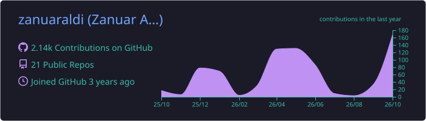
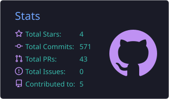
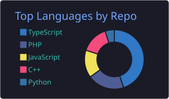
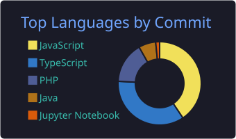
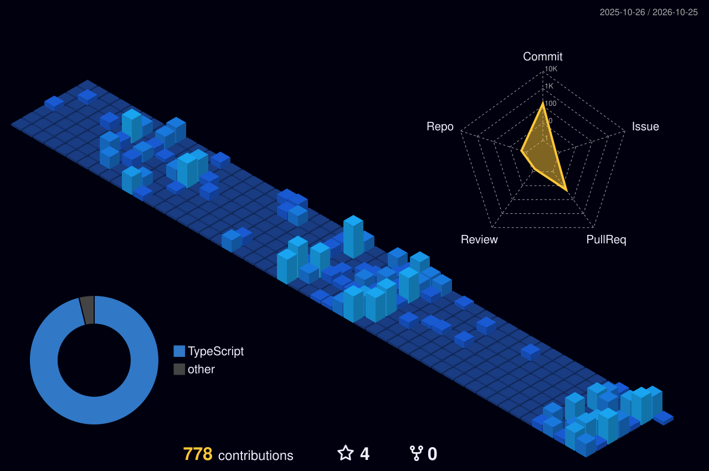

 

## About

Full-stack developer who builds web applications that are clean, fast, and easy to maintain, from APIs and admin dashboards to polished user interfaces. I also enjoy exploring game development.

- **Web applications:** Laravel, Filament, and Livewire for maintainable back-office tools
- **APIs:** REST APIs with JWT authentication on top of PostgreSQL and MySQL
- **Frontend:** React, TypeScript, and Vite
- **Game development:** experimenting with game projects and mechanics

 

## Tech Stack

| Area | Stack |
| :--- | :--- |
| **Languages** |  |
| **Frameworks & Libraries** |  |
| **Data & Infrastructure** |  |
| **Tooling** |  |

Also working with: **Filament** · **Livewire** · **JWT** · **Microsoft SQL Server**

 

## GitHub Stats

  
  
  
  

 

## Contribution Graph

  

 

## Contribution Snake

  <picture>
    <source media="(prefers-color-scheme: dark)" srcset="https://raw.githubusercontent.com/zanuaraldi/zanuaraldi/output/github-snake-dark.svg" />
    <source media="(prefers-color-scheme: light)" srcset="https://raw.githubusercontent.com/zanuaraldi/zanuaraldi/output/github-snake.svg" />
    
  </picture>

 

## Connect

