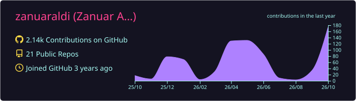
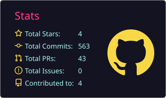
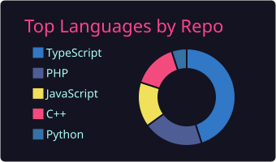
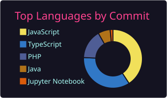
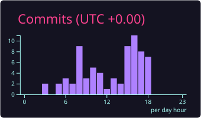

---

# 💫 About Me

- 🎓 Mahasiswa **Teknik Informatika** di **Politeknik Negeri Malang**
- 🎮 Tertarik pada **game development** dan **software engineering**
- 🛠️ Sehari-hari membangun aplikasi web dengan **Laravel**, **React**, dan **TypeScript**
- 🌱 Sedang belajar: *(isi sendiri, misal: arsitektur backend, AI agent, dll.)*
- 📫 Kontak: *(isi email / LinkedIn / Instagram)*

---

# 💻 Tech Stack

**Languages** 

**Backend & Framework** 

**Frontend** 

**Database** 

**Tools** 

---

# 📊 GitHub Stats

  
  
  
  
  

---

# 🐍 Contribution Snake

  <picture>
    <source media="(prefers-color-scheme: dark)" srcset="https://raw.githubusercontent.com/zanuaraldi/zanuaraldi/output/github-snake-dark.svg" />
    <source media="(prefers-color-scheme: light)" srcset="https://raw.githubusercontent.com/zanuaraldi/zanuaraldi/output/github-snake.svg" />
    
  </picture>

---

